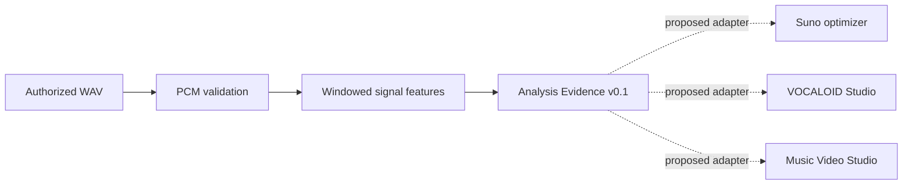

# AI-MUSIC-INTELLIGENCE-ENGINE

**Reproducible music analysis and evidence for human-led AI production.**  
音楽理解・歌唱解析・品質評価のための共通研究基盤。

Status: Phase 0 implementation candidate (2026-11-25 JST). This is not a trained music understanding model, pitch transcription engine or verified musical-quality predictor.



## Quick start
Python 3.11+, standard library only; no API calls or model downloads.
```sh
python -m unittest discover -s tests -v
python scripts/demo.py
python -m mir.analyze out/demo.wav --output out/evidence.json
```
The fixture is an original synthetic pulse train. The analyzer supports uncompressed PCM16 WAV, mono/stereo, bounded duration and sample rate. Reports include SHA-256, sample counts, RMS and sample peak (dBFS), clipping, silent-window fraction, candidate energy onsets and a conservative pulse-rate estimate. The estimate is not verified musical BPM. No transcription, pitch, phoneme, true-peak, LUFS or artist preference claim.

## Documents
- [Requirements and architecture](docs/requirements.md)
- [Evidence contract](docs/evidence_contract.md)
- [DVP/DVR and roadmap](docs/verification.md)
- [JSON Schema](schemas/analysis_evidence.schema.json)
- [Actions](https://github.com/Gacky-Lab/AI-MUSIC-INTELLIGENCE-ENGINE/actions)

## Related research
- [LYRIC-DESIGN-FRAMEWORK](https://github.com/Gacky-Lab/LYRIC-DESIGN-FRAMEWORK)
- [SUNO-GENERATION-OPTIMIZER](https://github.com/Gacky-Lab/SUNO-GENERATION-OPTIMIZER)
- [AI-VOCALOID-STUDIO](https://github.com/Gacky-Lab/AI-VOCALOID-STUDIO)
- [AI-MUSIC-VIDEO-STUDIO](https://github.com/Gacky-Lab/AI-MUSIC-VIDEO-STUDIO)

This project proposes a shared evidence layer; upstream integrations have not been implemented. No private audio, credentials or proprietary voicebanks are published. License undecided. Independent research, not affiliated with product providers.
