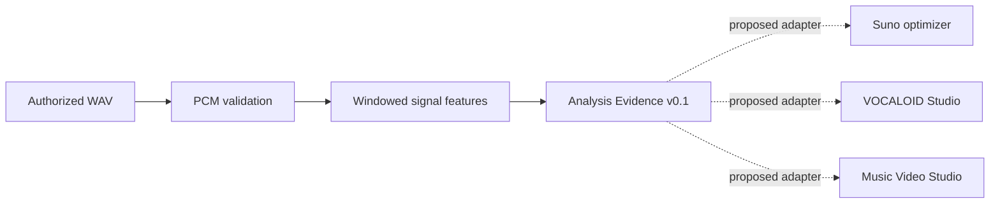

# AI-MUSIC-INTELLIGENCE-ENGINE

[](https://github.com/Gacky-Lab/AI-MUSIC-INTELLIGENCE-ENGINE/actions/workflows/offline.yml) · [Gacky-Lab research portfolio](https://github.com/Gacky-Lab/AI-MUSIC-VIDEO-STUDIO/blob/main/docs/profile/README.md)

**Reproducible music analysis and evidence for human-led AI production.**  
音楽理解・歌唱解析・品質評価のための共通研究基盤。

Status: Phase 0 offline synthetic verification passed (2026-11-25 JST). Optional monophonic pitch and review-only note candidate modules were also exercised in the pinned synthetic integration; real-song transcription accuracy remains unverified. CDE v0.1 is a separate research proposal (NOT_RUN). This is not a trained music understanding model or verified musical-quality predictor.



## Quick start
Python 3.11+, standard library only; no API calls or model downloads.
```sh
python -m unittest discover -s tests -v
python scripts/demo.py
python -m mir.analyze out/demo.wav --output out/evidence.json
```
The fixture is an original synthetic pulse train. The analyzer supports uncompressed PCM16 WAV, mono/stereo, bounded duration and sample rate. Reports include SHA-256, sample counts, RMS and sample peak (dBFS), clipping, silent-window fraction, candidate energy onsets and a conservative pulse-rate estimate. The estimate is not verified musical BPM. This base PCM analyzer does not estimate pitch, transcription, phonemes, true peak, LUFS or artist preference. Optional modules: [pitch baseline](docs/PITCH_BASELINE.md) and [review-only note candidates](docs/NOTE_CANDIDATES.md).

## Documents
- [Requirements and architecture](docs/requirements.md)
- [Evidence contract](docs/evidence_contract.md)
- [DVP/DVR and roadmap](docs/verification.md)
- [JSON Schema](schemas/analysis_evidence.schema.json)
- [Actions](https://github.com/Gacky-Lab/AI-MUSIC-INTELLIGENCE-ENGINE/actions)

## Research proposals
- [Creative Deviation Evaluation (CDE) v0.1](research/creative-deviation-evaluation/README.md) — a proposed protocol for separating artifact adoption from preference for unintended musical changes (empirical validation NOT_RUN).

## Related research
- [LYRIC-DESIGN-FRAMEWORK](https://github.com/Gacky-Lab/LYRIC-DESIGN-FRAMEWORK)
- [SUNO-GENERATION-OPTIMIZER](https://github.com/Gacky-Lab/SUNO-GENERATION-OPTIMIZER)
- [AI-VOCALOID-STUDIO](https://github.com/Gacky-Lab/AI-VOCALOID-STUDIO)
- [AI-MUSIC-VIDEO-STUDIO](https://github.com/Gacky-Lab/AI-MUSIC-VIDEO-STUDIO)

This project proposes a shared evidence layer; upstream integrations have not been implemented. No private audio, credentials or proprietary voicebanks are published. License undecided. Independent research, not affiliated with product providers.

## Verified evidence
[PR CI run](https://github.com/Gacky-Lab/AI-MUSIC-INTELLIGENCE-ENGINE/actions/runs/45542408140): Python 3.11 and 3.13 passed the eight-test suite and synthetic WAV demo; the known 120 pulses/min fixture yielded a 120.0 pulses/min candidate. JSON evidence is attached to CI artifacts. Real-song BPM/pitch/transcription/alignment and artistic-quality validation remain NOT_RUN. A later [pinned synthetic five-repository integration](https://github.com/Gacky-Lab/AI-MUSIC-VIDEO-STUDIO/blob/main/docs/FIVE_REPO_INTEGRATION.md) exercised pitch/note candidates and evidence handoff; this is not full live production or CDE validation.


Portfolio-level research status / 研究状態の一覧: [Research status](https://github.com/Gacky-Lab/Gacky-Lab/blob/main/docs/governance/RESEARCH_STATUS.md) · [Market-to-validation traceability](https://github.com/Gacky-Lab/Gacky-Lab/blob/main/docs/governance/RESEARCH_TRACEABILITY.md). The historical specification and scoped verification results remain authoritative for their original dates.
